  

### Hi, I'm Vivek 👋

Program Manager in **digital transformation** at a life insurer in Mumbai. 
I lead tech & digital for a **1,500+ field sales force**, and I build the automation and AI tools myself.

---

### 📊 Impact at work

| | |
|---|---|
| **38%** sales productivity uplift across a 1,200+ field workforce | **47% → 78%** early-tenure activation after redesigning incentives |
| **27+ pts** cut in first-year attrition | **+24 pts** channel NPS across 7 zones |
| **₹60 lakh+** annual savings from AI-led automation | **₹2 Cr** annual savings from an in-house screening platform (EdTech) |

5+ years across life insurance and EdTech: program management, sales enablement, incentive design and process automation.

### 🛠️ What I've built

| | |
|---|---|
| **🎯 Sales earnings planner** An earnings tracker and what-if simulator for field sales, replacing manual Excel incentive sheets, with auto-generated PDF statements. | **🔍 Field-visit photo verification** A vision-model pipeline that flags reused, screenshotted or off-context field photos, with a manager analytics dashboard. |
| **📣 Incentive communication automation** Daily pipeline that calculates incentives and sends each salesperson a personalised creative over WhatsApp and email. | **🧲 Lead & candidate sourcing engines** Zero-cost pipelines that find, score and enrich partner and candidate leads from public sources. |
| **🤖 Personal AI assistant** A WhatsApp agent that schedules, summarises and replies, and places real voice calls. | **📈 Investment research desk** An India-first research platform: portfolio X-ray, valuation lens and a live market feed. |

Most of this is private work. Happy to walk you through any of it.

### 🧰 Tools I use

  

  
  
  
  
  
  
  

### 🐍 Contributions

<picture>
  <source media="(prefers-color-scheme: dark)" srcset="https://raw.githubusercontent.com/Vivek4476/Vivek4476/output/snake-dark.svg"/>
  
</picture>

---

